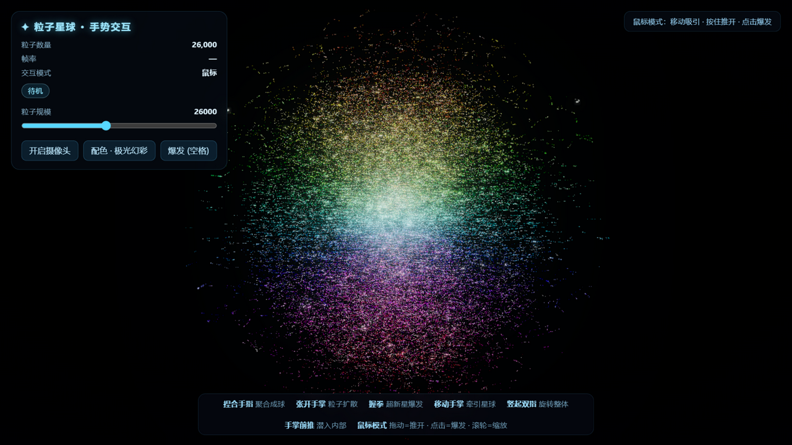
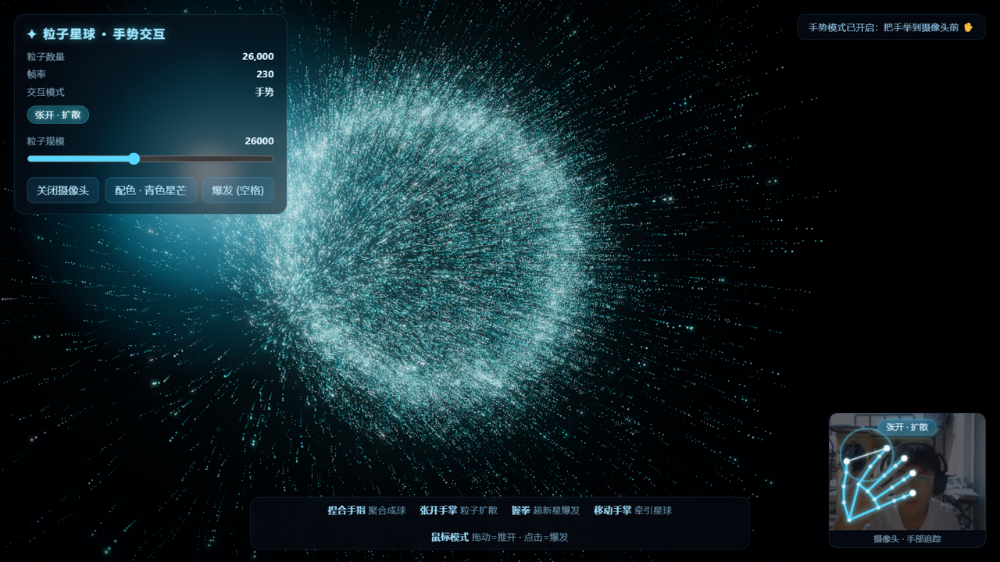
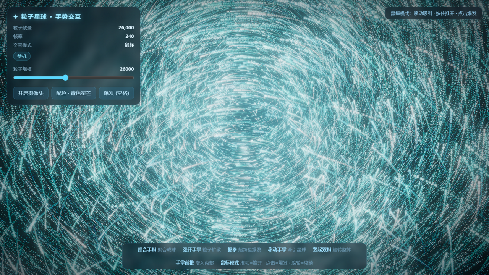

# ✦ 粒子星球 · 手势交互 (Particle Planet)

> 一个基于 **Three.js + MediaPipe** 的手势交互粒子作品：26,000 颗发光粒子组成一颗可以旋转、捏合、爆发、甚至可以"飞进去"的粒子星球。
>
> A gesture-controlled particle planet built with Three.js & MediaPipe HandLandmarker — single HTML file, no build step.

| 星球外观 | 手势追踪 | 潜入内部 |
|---|---|---|
|  |  |  |

## ✨ 特性

- **纯前端单文件**：全部代码（含物理、着色器、UI）内嵌于一个 `index.html`，无构建、无依赖安装
- **体积粒子星球**：中心致密、外围散冕的体积分布，中心亮核由数万粒子沿视线自然叠加形成
- **临界阻尼弹簧物理**：粒子回位零过冲，所有交互连续滑行、永不跳步
- **帧率无关**：拖尾运动模糊、缩放速度、弹簧行为在 60Hz / 144Hz / 240Hz 下表现一致
- **8 款配色**：青色星芒 / 翡翠光海 / 冰晶蓝白 / 紫色星云 / 樱粉星潮 / 熔金烈焰 / 赤色脉冲 / 极光幻彩（全彩渐变）
- **相机潜入**：可以一路推进粒子内部，从星球内部看发光核心
- **鼠标兜底**：没有摄像头也能完整体验

## 🖐 交互方式

### 摄像头手势模式（MediaPipe HandLandmarker，21 点追踪）

| 手势 | 效果 |
|------|------|
| ✋ 移动手掌 | 牵引整团粒子跟随手移动 |
| ✌️ 竖起食指 + 中指 | 旋转模式：手往哪偏，星球就往哪转（松手带惯性甩尾） |
| 🫲 手掌朝镜头前推 | 相机潜入粒子内部（收回手退出） |
| 🤏 捏合手指 | 粒子聚合成致密光球，跟随捏合点 |
| 🖐 张开手掌 | 粒子向外扩散、排斥 |
| ✊ 握拳 | 超新星爆发！粒子四散后自动复原 |

### 鼠标 / 键盘模式

| 操作 | 效果 |
|------|------|
| 移动鼠标 | 轻微吸引 |
| 按住拖动 | 推开粒子 |
| 单击 / 空格 | 超新星爆发 |
| 滚轮 | 推近 / 拉远（对数缩放，可潜入内部） |
| 数字键 1~8 / V | 切换配色 |

## 🚀 运行

**方式一（鼠标模式，最简单）**：直接双击 `index.html`（Chrome / Edge），联网即可，手势模型首次加载约 8MB。

**方式二（完整功能，含摄像头手势）**：受浏览器安全限制，`file://` 页面无法访问摄像头，需通过 localhost 运行：

```bash
python -m http.server 8931
# 打开 http://localhost:8931
```

摄像头授权弹窗选择"允许"即可开启手势模式；拒绝授权会自动回退到鼠标模式。

## 🔧 技术栈

- [Three.js](https://github.com/mrdoob/three.js) r160 — WebGL 渲染、`UnrealBloomPass` 辉光 + `AfterimagePass` 运动模糊后期
- [MediaPipe Tasks Vision](https://github.com/google-ai-edge/mediapipe) — HandLandmarker 手部 21 点追踪（GPU 优先、超时自动降级 CPU）
- 原生 JS 粒子物理 — 斐波那契球分布 + 临界阻尼弹簧 + 涡旋吸引/排斥场 + 爆发噪声漂移，全局限速保证连续流运动
- 自定义 GLSL 点着色器 — 柔光粒子、透视尺寸钳制

## 📁 结构

```
├── index.html    # 全部源码（844 行，中文注释，无压缩）
├── docs/         # 截图
└── LICENSE       # MIT
```

## 💡 灵感来源

灵感来自抖音 [@澜安AIGC](https://v.douyin.com/-NxParNBO44/) 的 Gemini 3 Pro 粒子手势交互视频，在其玩法（捏合聚合 / 张开扩散 / 握拳爆发）基础上做了自己的实现与扩展（体积分布、相机潜入、双指旋转、多配色、帧率无关管线等）。

## 📄 License

[MIT](LICENSE)
